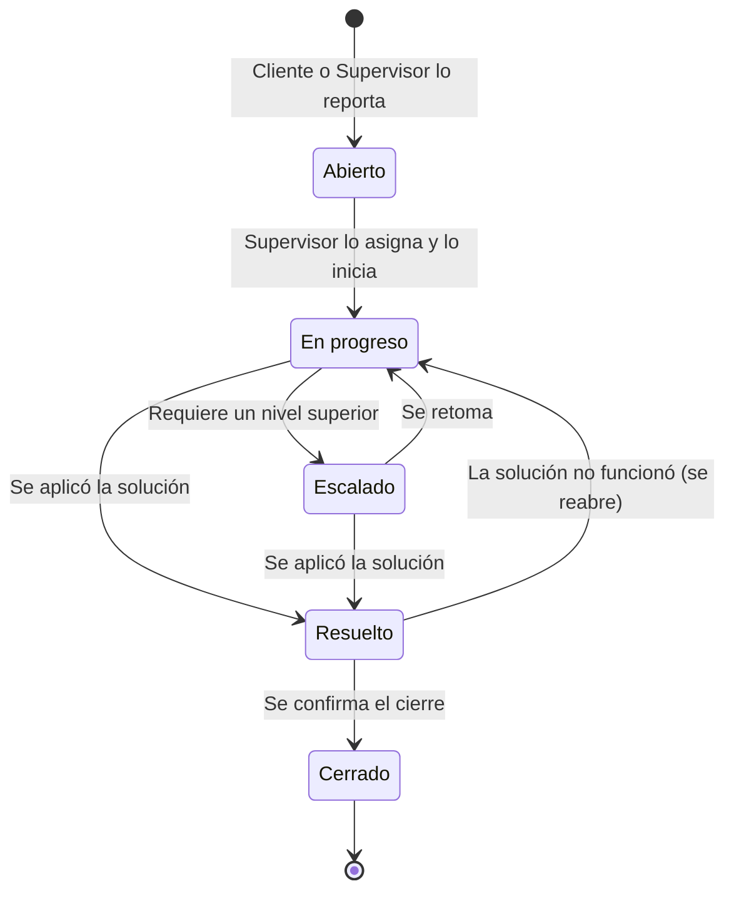

# 1. Propuesta del dominio

**Proyecto:** SentryGuard · **Asignatura:** Lenguaje de Programación Web II · **Evaluación 3, Hito 1**

**Equipo:** Adriel Troncoso, Bastián Ovalle y [integrante por confirmar]. La pauta exige entre 3 y 4 integrantes.

**Aprobación del docente:** [PENDIENTE: registrar aquí la fecha y la forma en que el docente aprobó el dominio].

> Todo el dominio es ficticio. «CyberOps Chile SpA» y sus empresas clientes son inventadas, y todos los datos del sistema son sintéticos: no hay datos personales reales.

## 1.1 Contexto

CyberOps Chile SpA (ficticia) es un proveedor de servicios de ciberseguridad gestionada. Atiende a varias empresas clientes que le reportan incidentes (phishing, malware, accesos no autorizados, caídas de servicio) sobre sus activos tecnológicos. Cada cliente tiene un plan de servicio y, opcionalmente, un contrato de nivel de servicio (SLA) que fija cuántas horas tiene CyberOps para resolver un incidente según su severidad.

## 1.2 Problema

Sin un sistema común, los incidentes se reportan por correo o teléfono, lo que trae varios problemas:

- No queda un registro único de qué ocurrió, quién lo atendió ni cuándo.
- Los supervisores no saben qué incidentes están por vencer su SLA ni cuál es la carga de cada analista.
- Los clientes no ven el avance de sus incidentes.
- La gerencia no tiene indicadores (volumen, cumplimiento del SLA, tiempo de resolución) para decidir.

## 1.3 Objetivo

Construir un sistema web que permita **registrar, asignar, atender y cerrar incidentes de ciberseguridad** con trazabilidad completa y control del SLA. Además, que entregue un **dashboard** y **reportes exportables** para la toma de decisiones, con apoyo de **IA** para resumir información y sugerir la clasificación de los incidentes.

## 1.4 Usuarios y roles

| Rol | Quién es | Qué hace en el sistema |
|---|---|---|
| **Administrador** | Personal de TI de CyberOps | Administra usuarios, organizaciones, contratos SLA, catálogos y la auditoría. Tiene todos los permisos |
| **Supervisor** | Jefe del centro de operaciones | Asigna incidentes a analistas, cambia su estado, gestiona activos y revisa el dashboard y los reportes |
| **Analista** | Especialista de CyberOps | Atiende los incidentes que tiene asignados: documenta la bitácora y registra evidencias |
| **Cliente** | Usuario de una empresa cliente | Reporta incidentes sobre los activos de su organización y sigue su avance y su SLA |

Los cuatro roles tienen permisos distintos; la matriz completa está en [02_requerimientos_historias.md](02_requerimientos_historias.md#24-matriz-de-permisos).

## 1.5 Casos de uso principales

| # | Caso de uso | Actor principal | Estado |
|---|---|---|---|
| CU-01 | Reportar un incidente sobre un activo propio | Cliente | Implementado |
| CU-02 | Asignar un incidente a un analista | Supervisor | Implementado |
| CU-03 | Avanzar el incidente por su flujo de estados, validando que la transición sea válida | Supervisor | Implementado sin validar la transición (se agrega en el Hito 2) |
| CU-04 | Documentar la atención: bitácora y evidencias | Analista | Implementado |
| CU-05 | Consultar el cumplimiento del SLA de un incidente | Cliente, Supervisor | Implementado |
| CU-06 | Administrar organizaciones y sus contratos SLA | Administrador | Implementado |
| CU-07 | Administrar activos de una organización | Supervisor | Implementado |
| CU-08 | Administrar usuarios y roles | Administrador | Implementado |
| CU-09 | Revisar la auditoría de cambios | Administrador | Implementado parcialmente (se amplía en el Hito 2) |
| CU-10 | Analizar indicadores en el dashboard con filtros | Supervisor, Administrador | Planificado (Hito 4) |
| CU-11 | Generar, exportar e imprimir reportes | Supervisor, Administrador, Cliente (solo su organización) | Planificado (Hito 4) |
| CU-12 | Obtener una sugerencia de severidad y categoría al reportar un incidente, y confirmarla | Cliente, Supervisor | Planificado (Hito 3) |
| CU-13 | Obtener un resumen en lenguaje natural del dashboard o de un reporte | Supervisor, Administrador | Planificado (Hito 3) |

## 1.6 Flujo de estados del incidente

El incidente avanza por un flujo cerrado. Una transición que no aparece en el diagrama se rechaza en la API, que responde 409 con el formato de error estándar (esta validación se agrega en el Hito 2).

- **Al pasar a Resuelto o Cerrado** se registra la fecha de cierre, que detiene el reloj del SLA. Si vuelve a En progreso, la fecha de cierre se borra y el reloj sigue corriendo.
- **Cada transición** queda en la bitácora con el estado anterior, el nuevo, el usuario y la hora.
- **Prohibido:** saltar de Abierto a Cerrado, reabrir un incidente Cerrado o volver a Abierto desde cualquier estado.

## 1.7 Alcance del producto mínimo viable

**Incluye:** todo lo de la tabla de casos de uso; al menos 500 incidentes sintéticos repartidos en 12 meses; la ejecución completa con `docker compose up`; un pipeline de CI/CD y un plan de despliegue escrito.

**No incluye** (queda como mejora futura):

- Subir archivos binarios de evidencia (se registra la referencia al archivo).
- Notificaciones por correo.
- Inicio de sesión con proveedores externos.
- Despliegue real en la nube (la pauta pide el plan, no el despliegue).

## 1.8 Por qué este dominio

- **Es continuidad de los Trabajos 1 y 2**, por lo que el equipo parte con una API y un frontend que ya funcionan, y puede concentrar las cinco semanas en lo nuevo: datos, dashboard, reportes, IA y despliegue.
- **Tiene un flujo con estados real**, con reglas de negocio no triviales (el SLA por contrato, la asignación y la visibilidad por organización) y una entidad principal que acumula historia, ideal para el análisis de datos.
- **La IA aporta valor concreto:** clasificar la descripción libre que escribe un cliente y resumir indicadores para la gerencia.
