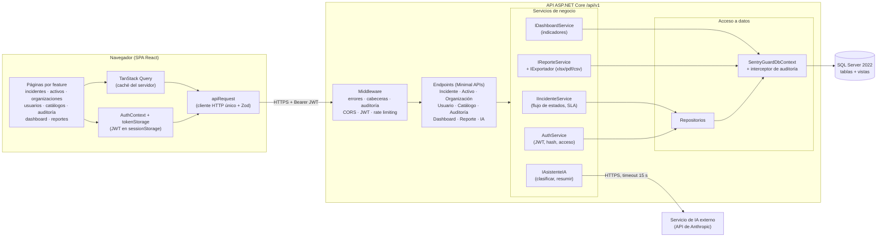
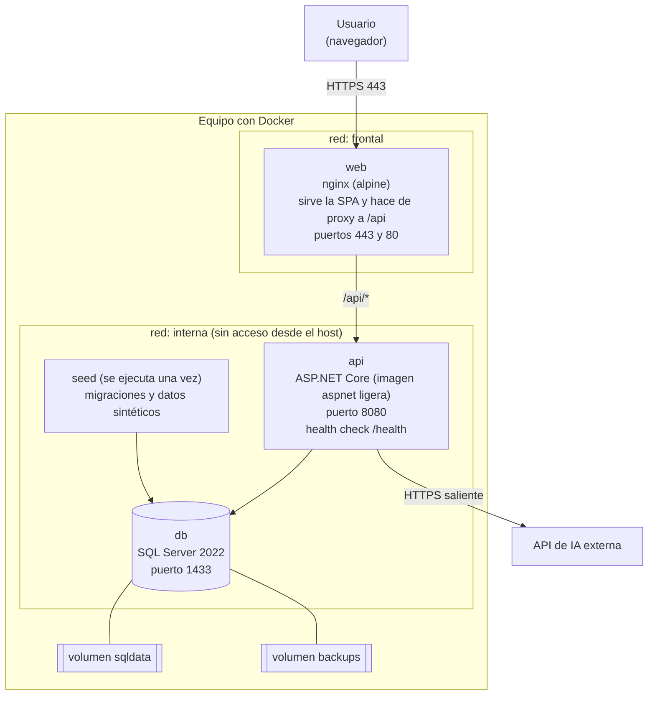

# 3. Arquitectura de software

Este documento distingue lo que **ya existe** en el código de lo que **se construye** en los hitos siguientes. Así la documentación coincide con el código en cada entrega. Las decisiones y las alternativas descartadas están en [04_decisiones_adr.md](04_decisiones_adr.md).

## 3.1 Vista general

SentryGuard es una aplicación web de una página (SPA) en React que consume una API REST en ASP.NET Core. La API guarda los datos en SQL Server mediante EF Core y consulta un servicio de IA externo.

| Capa | Tecnología | Carpeta | Responsabilidad |
|---|---|---|---|
| **Presentación** | React 19 + TypeScript (Vite), React Router, TanStack Query, React Hook Form + Zod | `sentryguard-web/src/` | Pantallas por rol, validación inmediata, estado del servidor en caché, accesibilidad |
| **API** | ASP.NET Core 10, Minimal APIs, OpenAPI y Scalar | `SentryGuard/Endpoints/`, `Middleware/` | Rutas, verbos y códigos HTTP; autenticación y autorización; validación de la entrada; formato de error; sin reglas de negocio |
| **Servicios de negocio** | C# con interfaces e inyección de dependencias | `SentryGuard/Services/` | Reglas del dominio: flujo de estados, SLA, visibilidad por rol, reportes, indicadores, IA |
| **Acceso a datos** | EF Core 10 (Repository + `DbContext`), migraciones | `SentryGuard/Repositories/`, `Data/`, `Migrations/` | Consultas, persistencia, transacciones, auditoría |
| **Base de datos** | SQL Server 2022 | (contenedor) | Integridad: claves, únicos, CHECK, vistas para reportes |

### Estado actual y objetivo

| Aspecto | Hoy (fin del Trabajo 2) | Objetivo (Hito 2) |
|---|---|---|
| Lógica de negocio | En los endpoints, que usan `SentryGuardDbContext` directamente | En servicios con interfaz (`IIncidenteService`, `IReporteService`, `IDashboardService`…); los endpoints solo traducen HTTP |
| Repository | Existe (`Repositories/`), pero los endpoints lo usan solo para crear, actualizar y eliminar | Los servicios acceden a los datos por repositorios; las consultas complejas usan especificaciones o vistas |
| Servicios | Solo `AuthService` (clase concreta) | Todos con interfaz, registrados en `Program.cs` |
| Pruebas | 24 de integración (API real con SQL Server de prueba) | Más pruebas unitarias de los servicios con repositorios y un cliente de IA falsos |
| Formato de error | Tres formatos distintos | Uno solo, *ProblemDetails* (RFC 9457), con `codigo` y `traceId` (se toma `ApiResults.cs` de SentryGuard-2) |

## 3.2 Diagrama de componentes

`IDashboardService`, `IReporteService`, `IAsistenteIA` y el interceptor de auditoría se crean en los Hitos 2 a 4. El resto ya existe, aunque hoy con la lógica en los endpoints.

## 3.3 Diagrama de despliegue

Así arranca el sistema con `docker compose up` (Hito 3). El detalle de los puertos, volúmenes y variables está en [08_plan_trabajo.md](08_plan_trabajo.md#86-entorno-de-contenedores-previsto) y, más adelante, en el plan de despliegue.

- **Solo `web` expone puertos al host.** La API y la base de datos quedan en la red interna.
- **Variables** (en `.env`, fuera del repositorio; se entrega `.env.example`): `SA_PASSWORD`, `ConnectionStrings__DefaultConnection`, `Jwt__Key`, `Jwt__Issuer`, `Jwt__Audience`, `Cors__AllowedOrigins__0`, `IA__ApiKey`, `IA__Modelo`, `IA__TimeoutSegundos`.
- **Política de reinicio** `unless-stopped` y *health checks* en `api` y `db`. `api` espera a que `db` esté sana.

## 3.4 Patrones de diseño

| Patrón | Dónde | Estado | Por qué |
|---|---|---|---|
| **Repository** | `Repositories/IRepository.cs`, `Repository.cs` y los repositorios por entidad | ✅ existe, se usa más desde el Hito 2 | Separa la lógica de negocio de EF Core y permite probar los servicios con repositorios falsos |
| **Inyección de dependencias** | `Program.cs` (`AddScoped`) | ✅ | Desacopla las clases de sus dependencias (principio D de SOLID) |
| **Cadena de responsabilidad (pipeline de middleware)** | `Middleware/` (errores, cabeceras, auditoría) | ✅ | Cada aspecto transversal es un eslabón independiente que se puede agregar o quitar |
| **DTO y proyección** | `DTOs/DTOs.cs`, expresiones `ADto` | ✅ | La API nunca devuelve entidades EF: evita fugas de datos (OWASP API3) y ciclos de serialización |
| **Strategy** | `IExportador` con `ExportadorExcel`, `ExportadorPdf` y `ExportadorCsv` | 📋 Hito 4 | Un mismo reporte se exporta a varios formatos sin `if` por formato; agregar uno nuevo no cambia el servicio (principio O) |
| **Adapter** | `IAsistenteIA` con `AsistenteAnthropic` y `AsistenteFalso` (pruebas) | 📋 Hito 3 | Aísla el proveedor de IA: se puede cambiar o simular sin tocar los endpoints |
| **State (tabla de transiciones)** | `tb_TransicionEstado` + `IIncidenteService.CambiarEstado` | 📋 Hito 2 | Las transiciones válidas son datos, no `if` repartidos en el código |

### SOLID en el código

- **S, responsabilidad única:** cada middleware hace una sola cosa; desde el Hito 2, los endpoints solo traducen HTTP y los servicios solo aplican reglas.
- **O, abierto/cerrado:** exportadores e IA detrás de interfaces; agregar un formato o un proveedor no modifica el código que los usa.
- **L, sustitución de Liskov:** `AsistenteFalso` reemplaza a `AsistenteAnthropic` en las pruebas sin cambiar el comportamiento esperado por el servicio.
- **I, segregación de interfaces:** interfaces chicas por necesidad (`IExportador` tiene un solo método), en lugar de un servicio gigante.
- **D, inversión de dependencias:** los endpoints y servicios dependen de interfaces registradas en el contenedor de dependencias, no de clases concretas.

## 3.5 Cómo atiende la arquitectura los requerimientos no funcionales

| RNF | Decisión de arquitectura |
|---|---|
| RNF-01 Rendimiento | Paginación en el servidor (máx. 50), índices en las FK y en `fecha_creacion`, agregaciones en vistas SQL y no en memoria, caché del cliente con TanStack Query, vistas del frontend cargadas bajo demanda |
| RNF-02/03 Seguridad | JWT firmado, rol y organización validados en cada endpoint, DTOs, rate limiting, CORS restringido, cabeceras de seguridad, secretos en variables de entorno |
| RNF-04 Disponibilidad | Contenedores con *health check* y reinicio automático; la API espera a que la base esté sana |
| RNF-05 Recuperación | Volumen de respaldos separado del de datos y procedimiento de restauración probado |
| RNF-06/07 Accesibilidad y usabilidad | Componentes reutilizables accesibles por diseño (`FormField`, `ConfirmDialog`, `ListadoResponsivo`), sistema de diseño con contrastes verificados |
| RNF-08 Mantenibilidad | Capas con interfaces, inyección de dependencias, pruebas unitarias y de integración en CI |
| RNF-09 Portabilidad | Todo en contenedores con versiones fijas; un solo comando para arrancar |
| RNF-10 Integración con IA | Adaptador con `HttpClient` tipado y *timeout*; los errores se traducen al formato estándar; la funcionalidad principal no depende de la IA |
| RNF-11 Auditabilidad | Interceptor de `SaveChanges` que registra cada cambio de entidad, más el registro explícito de las exportaciones |
| RNF-12 Calidad | GitHub Actions: compila, prueba y publica la imagen solo si las pruebas pasan |
