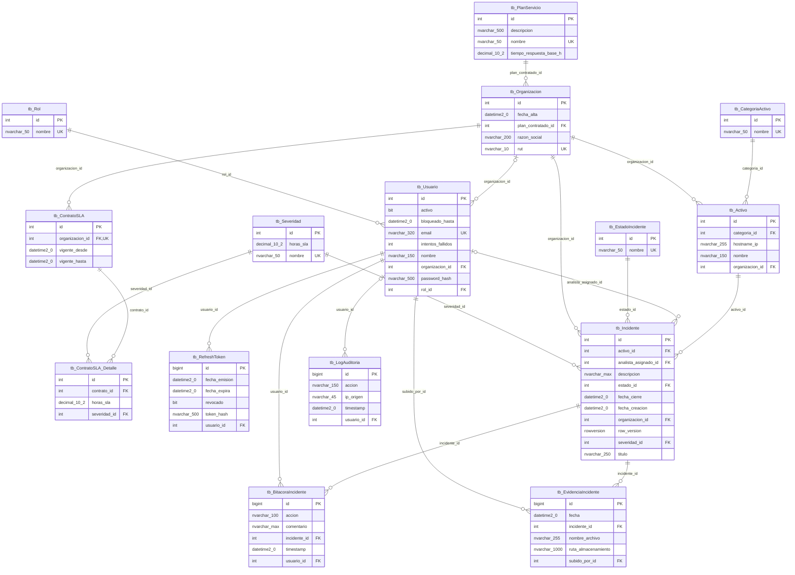
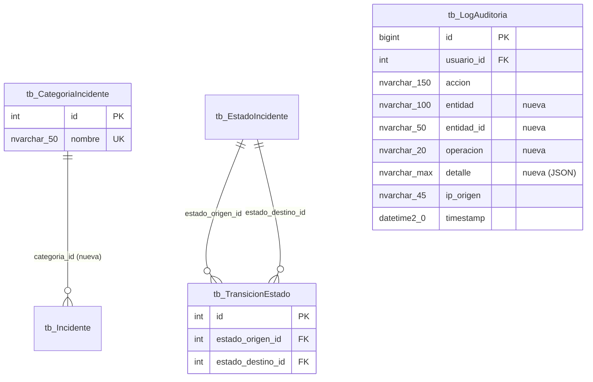

# 5. Modelo de datos

El diagrama y el diccionario de las secciones 5.1 y 5.3 se **generaron desde el esquema real**: el *snapshot* de migraciones de EF Core, `SentryGuard/Migrations/SentryGuardDbContextModelSnapshot.cs`. Reflejan lo que hay hoy en la base. Los cambios del Hito 2 están aparte, en la sección 5.4.

**Convenciones:** tablas `tb_NombreEntidad`, columnas en `snake_case`, clases C# en PascalCase mapeadas con `[Column]`. Todas las fechas se guardan en UTC.

## 5.1 Diagrama entidad–relación (actual: 15 tablas)

`||--o{` significa uno a muchos obligatorio; `|o--o{`, uno a muchos opcional (la FK admite nulos).

## 5.2 Normalización

El modelo está en **tercera forma normal (3FN)**:

- **1FN:** todos los atributos son atómicos. Por ejemplo, las horas de SLA por severidad no se guardan como una lista dentro del contrato: van en `tb_ContratoSLA_Detalle`, una fila por severidad.
- **2FN:** todas las tablas tienen una clave primaria simple (`id`), así que no hay dependencias parciales de una clave compuesta. En `tb_ContratoSLA_Detalle`, el par (`contrato_id`, `severidad_id`) es único y `horas_sla` depende del par completo.
- **3FN:** no hay dependencias transitivas. Los nombres de los catálogos (severidad, estado, categoría, plan, rol) viven en su propia tabla y se referencian por FK, en lugar de repetirse en cada incidente o activo.

**Desnormalización deliberada:** `tb_Incidente.organizacion_id` se puede deducir del activo (`tb_Activo.organizacion_id`). Se guarda igual por dos motivos:

- El filtro por organización es la consulta más frecuente (visibilidad del Cliente, dashboard, reportes) y así se evita un *join* en cada una.
- El incidente queda ligado a la organización que tenía al crearse.

La API la llena siempre desde el activo, nunca desde el cuerpo de la petición (OWASP API1). En el Hito 2 se agrega una restricción que asegure la coherencia (sección 5.4).

## 5.3 Diccionario de datos (actual)

### `tb_Rol`

Catálogo de roles de acceso (Administrador, Supervisor, Analista, Cliente).

| Columna | Tipo | Nulo | Clave | Restricción o valor por defecto |
|---|---|---|---|---|
| `id` | int | No | PK (identidad) |  |
| `nombre` | nvarchar(50) | No |  |  |

Índices: Único (nombre).

### `tb_PlanServicio`

Catálogo de planes que contrata una organización, con su tiempo de respuesta base.

| Columna | Tipo | Nulo | Clave | Restricción o valor por defecto |
|---|---|---|---|---|
| `id` | int | No | PK (identidad) |  |
| `descripcion` | nvarchar(500) | Sí |  |  |
| `nombre` | nvarchar(50) | No |  |  |
| `tiempo_respuesta_base_h` | decimal(10,2) | No |  |  |

Índices: Único (nombre).

### `tb_CategoriaActivo`

Catálogo de tipos de activo (servidor, red, aplicación…).

| Columna | Tipo | Nulo | Clave | Restricción o valor por defecto |
|---|---|---|---|---|
| `id` | int | No | PK (identidad) |  |
| `nombre` | nvarchar(50) | No |  |  |

Índices: Único (nombre).

### `tb_Severidad`

Catálogo de severidades de incidente con las horas de SLA por defecto.

| Columna | Tipo | Nulo | Clave | Restricción o valor por defecto |
|---|---|---|---|---|
| `id` | int | No | PK (identidad) |  |
| `horas_sla` | decimal(10,2) | No |  |  |
| `nombre` | nvarchar(50) | No |  |  |

Índices: Único (nombre).

### `tb_EstadoIncidente`

Catálogo de estados del flujo del incidente.

| Columna | Tipo | Nulo | Clave | Restricción o valor por defecto |
|---|---|---|---|---|
| `id` | int | No | PK (identidad) |  |
| `nombre` | nvarchar(50) | No |  |  |

Índices: Único (nombre).

### `tb_Organizacion`

Empresa cliente de CyberOps Chile (dueña de activos e incidentes).

| Columna | Tipo | Nulo | Clave | Restricción o valor por defecto |
|---|---|---|---|---|
| `id` | int | No | PK (identidad) |  |
| `fecha_alta` | datetime2(0) | No |  | Por defecto "SYSUTCDATETIME( |
| `plan_contratado_id` | int | No | FK → `tb_PlanServicio` (Restrict) |  |
| `razon_social` | nvarchar(200) | No |  |  |
| `rut` | nvarchar(10) | No |  |  |

Índices: Índice (plan_contratado_id); Único (rut).

### `tb_ContratoSLA`

Contrato de nivel de servicio de una organización, con su vigencia.

| Columna | Tipo | Nulo | Clave | Restricción o valor por defecto |
|---|---|---|---|---|
| `id` | int | No | PK (identidad) |  |
| `organizacion_id` | int | No | FK → `tb_Organizacion` (Restrict) |  |
| `vigente_desde` | datetime2(0) | No |  |  |
| `vigente_hasta` | datetime2(0) | Sí |  |  |

Índices: Único (organizacion_id) (filtro `[vigente_hasta] IS NULL`).

### `tb_ContratoSLA_Detalle`

Horas comprometidas por severidad dentro de un contrato SLA.

| Columna | Tipo | Nulo | Clave | Restricción o valor por defecto |
|---|---|---|---|---|
| `id` | int | No | PK (identidad) |  |
| `contrato_id` | int | No | FK → `tb_ContratoSLA` (Cascade) |  |
| `horas_sla` | decimal(10,2) | No |  |  |
| `severidad_id` | int | No | FK → `tb_Severidad` (Restrict) |  |

Índices: Índice (severidad_id); Único (contrato_id, severidad_id).

### `tb_Usuario`

Cuenta de acceso; los Cliente pertenecen a una organización, el staff no.

| Columna | Tipo | Nulo | Clave | Restricción o valor por defecto |
|---|---|---|---|---|
| `id` | int | No | PK (identidad) |  |
| `activo` | bit | No |  | Por defecto true |
| `bloqueado_hasta` | datetime2(0) | Sí |  |  |
| `email` | nvarchar(320) | No |  |  |
| `intentos_fallidos` | int | No |  | Por defecto 0 |
| `nombre` | nvarchar(150) | No |  |  |
| `organizacion_id` | int | Sí | FK → `tb_Organizacion` (Restrict) |  |
| `password_hash` | nvarchar(500) | No |  |  |
| `rol_id` | int | No | FK → `tb_Rol` (Restrict) |  |

Índices: Único (email); Índice (organizacion_id); Índice (rol_id).

### `tb_RefreshToken`

Token de renovación de sesión emitido al iniciar sesión (se guarda solo su hash).

| Columna | Tipo | Nulo | Clave | Restricción o valor por defecto |
|---|---|---|---|---|
| `id` | bigint | No | PK (identidad) |  |
| `fecha_emision` | datetime2(0) | No |  | Por defecto "SYSUTCDATETIME( |
| `fecha_expira` | datetime2(0) | No |  |  |
| `revocado` | bit | No |  | Por defecto false |
| `token_hash` | nvarchar(500) | No |  |  |
| `usuario_id` | int | No | FK → `tb_Usuario` (Cascade) |  |

Índices: Índice (fecha_expira); Índice (usuario_id).

### `tb_Activo`

Activo tecnológico de una organización afectado por incidentes.

| Columna | Tipo | Nulo | Clave | Restricción o valor por defecto |
|---|---|---|---|---|
| `id` | int | No | PK (identidad) |  |
| `categoria_id` | int | No | FK → `tb_CategoriaActivo` (Restrict) |  |
| `hostname_ip` | nvarchar(255) | Sí |  |  |
| `nombre` | nvarchar(150) | No |  |  |
| `organizacion_id` | int | No | FK → `tb_Organizacion` (Restrict) |  |

Índices: Índice (categoria_id); Índice (organizacion_id).

### `tb_Incidente`

Entidad principal: incidente de ciberseguridad reportado sobre un activo.

| Columna | Tipo | Nulo | Clave | Restricción o valor por defecto |
|---|---|---|---|---|
| `id` | int | No | PK (identidad) |  |
| `activo_id` | int | No | FK → `tb_Activo` (Restrict) |  |
| `analista_asignado_id` | int | Sí | FK → `tb_Usuario` (Restrict) |  |
| `descripcion` | nvarchar(max) | No |  |  |
| `estado_id` | int | No | FK → `tb_EstadoIncidente` (Restrict) |  |
| `fecha_cierre` | datetime2(0) | Sí |  |  |
| `fecha_creacion` | datetime2(0) | No |  | Por defecto "SYSUTCDATETIME( |
| `organizacion_id` | int | No | FK → `tb_Organizacion` (Restrict) |  |
| `row_version` | rowversion | Sí |  |  |
| `severidad_id` | int | No | FK → `tb_Severidad` (Restrict) |  |
| `titulo` | nvarchar(250) | No |  |  |

Índices: Índice (activo_id); Índice (analista_asignado_id); Índice (estado_id); Índice (fecha_creacion); Índice (organizacion_id); Índice (severidad_id).

### `tb_BitacoraIncidente`

Historial del incidente: entradas automáticas del flujo y notas del equipo.

| Columna | Tipo | Nulo | Clave | Restricción o valor por defecto |
|---|---|---|---|---|
| `id` | bigint | No | PK (identidad) |  |
| `accion` | nvarchar(100) | No |  |  |
| `comentario` | nvarchar(max) | Sí |  |  |
| `incidente_id` | int | No | FK → `tb_Incidente` (Cascade) |  |
| `timestamp` | datetime2(0) | No |  | Por defecto "SYSUTCDATETIME( |
| `usuario_id` | int | No | FK → `tb_Usuario` (Restrict) |  |

Índices: Índice (incidente_id); Índice (timestamp); Índice (usuario_id).

### `tb_EvidenciaIncidente`

Referencia a un archivo de evidencia guardado en un repositorio externo.

| Columna | Tipo | Nulo | Clave | Restricción o valor por defecto |
|---|---|---|---|---|
| `id` | bigint | No | PK (identidad) |  |
| `fecha` | datetime2(0) | No |  | Por defecto "SYSUTCDATETIME( |
| `incidente_id` | int | No | FK → `tb_Incidente` (Cascade) |  |
| `nombre_archivo` | nvarchar(255) | No |  |  |
| `ruta_almacenamiento` | nvarchar(1000) | No |  |  |
| `subido_por_id` | int | No | FK → `tb_Usuario` (Restrict) |  |

Índices: Índice (incidente_id); Índice (subido_por_id).

### `tb_LogAuditoria`

Registro de cada escritura exitosa en la API (quién, qué ruta, desde qué IP, cuándo).

| Columna | Tipo | Nulo | Clave | Restricción o valor por defecto |
|---|---|---|---|---|
| `id` | bigint | No | PK (identidad) |  |
| `accion` | nvarchar(150) | No |  |  |
| `ip_origen` | nvarchar(45) | Sí |  |  |
| `timestamp` | datetime2(0) | No |  | Por defecto "SYSUTCDATETIME( |
| `usuario_id` | int | Sí | FK → `tb_Usuario` (SetNull) |  |

Índices: Índice (timestamp); Índice (usuario_id).

### Justificación de los índices

| Índice | Por qué existe |
|---|---|
| FK de `tb_Incidente` (`activo_id`, `estado_id`, `severidad_id`, `organizacion_id`, `analista_asignado_id`) | Son los filtros del listado, de la visibilidad por rol y de las agregaciones del dashboard |
| `tb_Incidente.fecha_creacion` | Orden por defecto del listado y filtros por rango de fechas en el dashboard y los reportes |
| Únicos en los nombres de los catálogos, `tb_Usuario.email` y `tb_Organizacion.rut` | Reglas de negocio: no puede haber dos con el mismo valor |
| `tb_ContratoSLA (organizacion_id)` único con filtro `vigente_hasta IS NULL` | Una organización tiene a lo más un contrato abierto, sin fecha de término |
| `tb_ContratoSLA_Detalle (contrato_id, severidad_id)` único | Una sola cantidad de horas por severidad en cada contrato |
| `tb_LogAuditoria (timestamp)` y `(usuario_id)` | Consulta de la auditoría por fecha y por usuario |

## 5.4 Cambios del Hito 2

**Estado (13 de noviembre de 2026):** la migración `AuditoriaCategoriaTransicionesVistas` implementa los cambios de la tabla siguiente, y los CHECK de la tabla siguiente se agregaron después con la migración `AgregaRestriccionesCheck` (23 de noviembre de 2026). Hay pruebas de integración en `AuditoriaCategoriaVistasApiTests.cs`. Dos diferencias con lo planificado: la auditoría por entidad guarda `valores_anteriores` y `valores_nuevos` (JSON) en lugar de `operacion` y `detalle`, y además `tb_Incidente` y `tb_Activo` llevan `fecha_creacion`, `fecha_modificacion`, `creado_por_id` y `modificado_por_id`, sellados por `SentryGuardDbContext.SaveChangesAsync`.

| Cambio | Tipo | Para qué |
|---|---|---|
| `tb_CategoriaIncidente (id, nombre único)` y `tb_Incidente.categoria_id` (FK, opcional en las filas existentes) | Nueva tabla y columna | Clasificar los incidentes (Phishing, Malware, Acceso no autorizado, Denegación de servicio, Fuga de datos, Otro). La usan la IA (RF-23) y el dashboard |
| `tb_TransicionEstado (id, estado_origen_id, estado_destino_id)`, con único en (`origen`, `destino`) y CHECK `origen <> destino` | Nueva tabla | Flujo de estados como datos (ADR-008) |
| `tb_LogAuditoria`: agregar `entidad`, `entidad_id`, `operacion` y `detalle` (JSON) | Columnas nuevas | Auditoría por entidad (ADR-010) |
| **Restricciones CHECK** | Restricciones | Que ningún dato se salte la validación de la base. Ver la tabla siguiente |
| **Vistas para reportes y dashboard:** `vw_IncidenteDetalle`, `vw_IndicadoresMensuales` y `vw_CumplimientoSla` | Vistas | Consultas preparadas para los reportes y las agregaciones, sin lógica duplicada en C# |

### Restricciones CHECK

Implementadas (las 9, entre las dos migraciones): `tb_TransicionEstado` (`origen <> destino`), `tb_Incidente` (`fecha_cierre IS NULL OR fecha_cierre >= fecha_creacion`) y la clave foránea compuesta `tb_Incidente (activo_id, organizacion_id)` hacia `tb_Activo (id, organizacion_id)`, que impide que un incidente declare una organización distinta a la de su activo. **Pendientes:** el resto de la tabla.

| Tabla | Restricción |
|---|---|
| `tb_Severidad` | `horas_sla > 0 AND horas_sla <= 720` |
| `tb_PlanServicio` | `tiempo_respuesta_base_h > 0` |
| `tb_ContratoSLA` | `vigente_hasta IS NULL OR vigente_hasta > vigente_desde` |
| `tb_ContratoSLA_Detalle` | `horas_sla > 0 AND horas_sla <= 720` |
| `tb_Incidente` | `fecha_cierre IS NULL OR fecha_cierre >= fecha_creacion`; `LEN(titulo) >= 5` |
| `tb_Organizacion` | RUT con formato `########-X` (`rut LIKE '%-%'` y largo entre 9 y 10) |
| `tb_Usuario` | `intentos_fallidos >= 0` |

Con los CHECK implementados, cada regla importante queda en **tres niveles**: el formulario (Zod), la API (`Validacion.cs`) y la base (CHECK, NOT NULL, únicos y FK).

### Diagrama de los cambios

## 5.5 Migraciones

El esquema se crea y versiona solo con migraciones de EF Core (`SentryGuard/Migrations/`):

| Migración | Qué hace |
|---|---|
| `20260908035923_InicialSentryGuard` | Crea las 15 tablas con sus claves, FK e índices |
| `20260908043801_SeedCatalogosYUsuariosPrueba` | Datos iniciales: roles, planes, categorías, severidades, estados, una organización de demostración y 4 usuarios de prueba |
| `20260908051535_StaffInternoSinOrganizacion` | El staff de CyberOps (Administrador, Supervisor, Analista) deja de pertenecer a una organización |
| `20261020082813_SeedActivosDemo` | Tres activos de demostración |

| `20261113131922_AuditoriaCategoriaTransicionesVistas` | Hito 2: `tb_CategoriaIncidente` (6 categorías) y `tb_Incidente.categoria_id`; `tb_TransicionEstado` (14 pares del flujo); campos de auditoría en `tb_Incidente` y `tb_Activo`; `entidad`, `entidad_id`, `valores_anteriores` y `valores_nuevos` en `tb_LogAuditoria`; CHECK y FK compuesta; vistas `vw_IncidenteDetalle`, `vw_CumplimientoSla` y `vw_IndicadoresMensuales` |
| `20261123014615_AgregaRestriccionesCheck` | Hito 4: las 8 restricciones CHECK restantes (severidad, plan, contrato SLA y su detalle, título mínimo del incidente, formato del RUT e intentos fallidos). Se revierte con `dotnet ef database update AuditoriaCategoriaTransicionesVistas` (ver `evidencias/reversion-migracion.md`) |

Las vistas y los CHECK se escriben con `migrationBuilder.Sql` porque EF no los genera solo. EF lee las vistas como entidades sin clave (`HasNoKey().ToView(...)`).

## 5.6 Estrategia de respaldo y restauración (probada el 13 de noviembre de 2026)

- **Respaldo completo diario** con `BACKUP DATABASE … TO DISK = '/var/opt/mssql/backups/…bak' WITH COMPRESSION, CHECKSUM`, ejecutado por un script dentro del contenedor `db`. Se guarda en el volumen `backups`, separado del volumen de datos.
- **Retención:** 7 respaldos diarios y 4 semanales.
- **Restauración:** `RESTORE DATABASE … FROM DISK = … WITH REPLACE` sobre una base vacía, y luego un conteo de filas por tabla para comparar con el original.
- **Objetivos:** RTO de 30 minutos y RPO de 24 horas (RNF-05).
- **Prueba:** `scripts/respaldo-restauracion.ps1` respalda la base, ejecuta `RESTORE VERIFYONLY`, la restaura como `SentryGuard_Restaurada`, compara el número de filas de 13 tablas y vistas con la original y deja el archivo en `backups/SentryGuard.bak` (0,75 MB comprimido). La salida de la última ejecución, con todos los conteos iguales, está en `docs/evidencias/respaldo-restauracion.txt`.
- **Alcance:** la prueba se hizo en SQL Server 2022 dentro del contenedor del `compose.yaml`. La retención de 7 diarios y 4 semanales y la programación diaria quedan descritas, pero **no automatizadas**.
