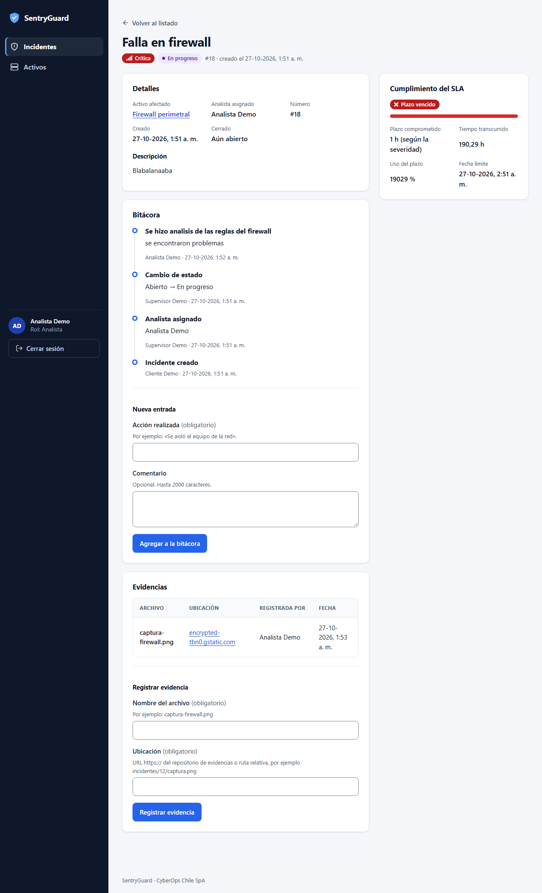
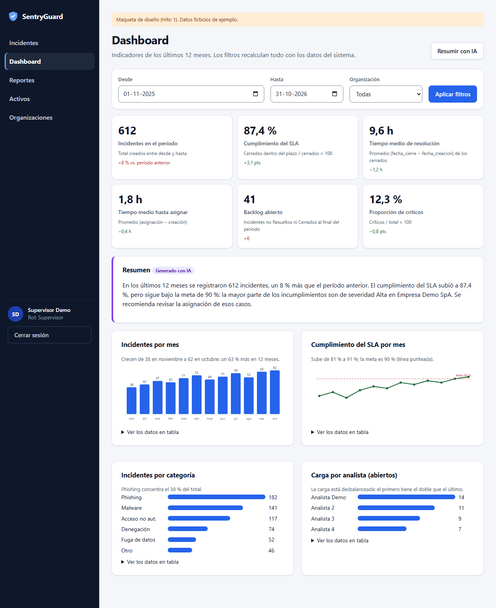

# 7. Maquetas y guía de estilos

## 7.1 Guía de estilos

El sistema de diseño es propio y no usa un framework de CSS. Todo está en `sentryguard-web/src/styles/global.css`, con variables CSS (*tokens*), y los componentes reutilizables están en `sentryguard-web/src/components/`.

### Paleta

Los contrastes se calcularon sobre fondo blanco, salvo que se indique otro. WCAG 2.2 AA pide 4,5:1 para el texto normal y 3:1 para los componentes.

| Token | Valor | Uso | Contraste |
|---|---|---|---|
| `--texto` | `#0f172a` | Texto principal | 17,9:1 |
| `--texto-suave` | `#475569` | Texto secundario, ayudas, encabezados de tabla | 7,6:1 |
| `--primario` | `#2563eb` | Botón principal, foco de los campos | 5,2:1 |
| `--primario-oscuro` | `#1d4ed8` | Enlaces, hover del botón principal | 6,7:1 |
| `--peligro` | `#b91c1c` | Errores, eliminar, SLA vencido | 6,5:1 |
| `--exito` | `#166534` | Notificación de éxito, SLA dentro del plazo | 7,1:1 (texto blanco sobre el color) |
| `--borde-control` | `#7c8595` | Borde de campos y selectores | 3,7:1 |
| `--fondo` / `--superficie` | `#f4f6fa` / `#ffffff` | Fondo de la página y de las tarjetas | — |
| `--lateral` | `#0f172a` | Barra lateral | Texto `#cbd5e1` a 12,0:1; foco `#fbbf24` a 10,7:1 |

**Severidad y estado** se muestran como insignias que combinan **texto con una forma**: barras de señal para la severidad y un punto para el estado. El color nunca es la única señal (WCAG 1.4.1). Todos los pares de texto y fondo superan 4,5:1.

| Insignia | Texto / fondo |
|---|---|
| Baja | `#166534` / `#dcfce7` |
| Media | `#854d0e` / `#fef9c3` |
| Alta | `#9a3412` / `#ffedd5` |
| Crítica | `#ffffff` / `#b91c1c` |
| Abierto | `#1e40af` / `#dbeafe` |
| En progreso | `#5b21b6` / `#ede9fe` |
| Escalado | `#9a3412` / `#ffedd5` |
| Resuelto | `#166534` / `#dcfce7` |
| Cerrado | `#334155` / `#e2e8f0` |

### Tipografía

- **Familia:** la fuente del sistema (`system-ui`, Segoe UI, Roboto…), sin descargas y legible en todas las plataformas.
- **Base:** 16 px (`font-size: 100%`) con interlineado de 1,5. Al ser relativa, respeta el tamaño que el usuario configure en el navegador.

| Nivel | Tamaño | Uso |
|---|---|---|
| Título de página (`h1`) | `clamp(1.5rem, 1.25rem + 1vw, 1.875rem)`, peso 750 | Un `h1` por vista |
| Indicador | 1,75 rem, peso 750 | Valores del resumen y del dashboard |
| Título de panel (`h2`) | 1,0625 rem, peso 700 | Secciones dentro de una vista |
| Cuerpo | 1 rem | Texto general |
| Controles y botones | 0,9375 rem, peso 600 | Botones, campos y etiquetas |
| Secundario | 0,875 rem | Metadatos, insignias, paginación |
| Ayuda | 0,8125 rem | Ayudas de los campos y etiquetas de los filtros |
| Encabezado de tabla | 0,75 rem, en mayúsculas | Columnas de las tablas |

### Escala de espaciado

Se usan múltiplos de 0,25 rem (4 px): **0,25 · 0,5 · 0,75 · 1 · 1,25 · 1,5 · 2 · 3 rem**.

- 0,5 y 0,75 rem: separación entre controles.
- 1 y 1,25 rem: separación entre bloques.
- 1,5 rem y más: separación entre secciones.

**Radios:** 0,5 rem en los controles y 0,75 rem en las tarjetas.

**Objetivo táctil mínimo:** 2,75 rem (44 × 44 px), por encima del mínimo de 24 × 24 px de WCAG 2.2.

### Puntos de quiebre

Mobile first:

| Desde | Cambios |
|---|---|
| Base (360 px o menos) | Una columna; menú plegable con el botón «Menú»; listados como tarjetas |
| 48 rem (768 px) | Filtros en una fila, tarjetas en 2 columnas, datos en 2 columnas |
| 64 rem (1024 px) | Barra lateral fija, tablas, detalle en dos columnas, datos en 3 columnas |

### Componentes reutilizables y sus estados

| Componente | Archivo | Estados visibles |
|---|---|---|
| Botón (`.boton--primario`, `--secundario`, `--peligro`, `--peligro-suave`) | `global.css` | Normal, hover, **foco** (contorno de 3 px), **activo**, **deshabilitado** (opacidad 0,55 y cursor no permitido) |
| Campo de formulario | `FormField.tsx` | Normal, hover, foco (borde azul y halo), **error** (borde rojo de 2 px, mensaje con ícono, `aria-invalid` y `aria-describedby`), deshabilitado |
| Resumen de errores | `ResumenErrores.tsx` | Aparece al enviar un formulario inválido y se anuncia (`role="alert"`) |
| Listado responsivo | `ListadoResponsivo.tsx` | Tabla en pantallas anchas y tarjetas en angostas |
| Filtros | `FiltrosListado.tsx` | Se aplican al enviar; tienen un botón para limpiar |
| Paginación | `Pagination.tsx` | Anterior y siguiente deshabilitados en los extremos |
| Diálogo de confirmación | `ConfirmDialog.tsx` | `<dialog>` nativo: atrapa el foco, se cierra con Esc y devuelve el foco al botón que lo abrió |
| Estados de carga, error y vacío | `LoadingState.tsx`, `ErrorState.tsx`, `EmptyState.tsx` | Carga anunciada (`role="status"`), error con «Reintentar», vacío con ícono y una variante compacta |
| Insignias | `Badges.tsx` | Severidad y estado |
| Menú | `Layout.tsx` | Enlace activo con fondo, barra y peso; menú móvil con `aria-expanded` |
| Íconos | `Icono.tsx` | Decorativos (`aria-hidden`); el texto da el nombre accesible |
| Vistas de error | `pages/NotFoundPage.tsx`, `AccessDeniedPage.tsx` | 404 y «Acceso denegado» |

## 7.2 Maquetas por rol

### Pantallas existentes

Son capturas de la aplicación real (fin del Trabajo 2, con el rediseño).

| Rol | Pantalla | Imagen |
|---|---|---|
| Administrador | Listado de incidentes con el resumen y los filtros | [actual-administrador-incidentes.png](maquetas/actual-administrador-incidentes.png) |
| Administrador | Usuarios | [actual-administrador-usuarios.png](maquetas/actual-administrador-usuarios.png) |
| Administrador | Catálogos | [actual-administrador-catalogos.png](maquetas/actual-administrador-catalogos.png) |
| Supervisor | Detalle de incidente con gestión (asignar y cambiar estado) | [actual-supervisor-detalle-incidente.png](maquetas/actual-supervisor-detalle-incidente.png) |
| Analista | Detalle de incidente asignado: solo bitácora y evidencias | [actual-analista-detalle-incidente.png](maquetas/actual-analista-detalle-incidente.png) |
| Cliente | Listado en celular (390 px) | [actual-cliente-incidentes-movil.png](maquetas/actual-cliente-incidentes-movil.png) |
| Cliente | Nuevo incidente en celular | [actual-cliente-nuevo-incidente-movil.png](maquetas/actual-cliente-nuevo-incidente-movil.png) |

### Pantallas nuevas (propuesta)

Están construidas con el mismo CSS de la aplicación (`maquetas/fuente/*.html`) y renderizadas en escritorio (1280 px) y en celular (390 px), sin desplazamiento horizontal. Los datos son de ejemplo.

| Rol | Pantalla | Escritorio | Celular |
|---|---|---|---|
| Supervisor | **Dashboard**: 6 indicadores con su fórmula y la variación, resumen con IA, 4 gráficos con descripción y tabla de datos, filtros | [escritorio](maquetas/propuesta-dashboard-escritorio.png) | [celular](maquetas/propuesta-dashboard-movil.png) |
| Supervisor | **Reportes**: elegir el reporte, filtros, totales, exportar a Excel, PDF y CSV, e imprimir | [escritorio](maquetas/propuesta-reportes-escritorio.png) | [celular](maquetas/propuesta-reportes-movil.png) |
| Cliente | **Nuevo incidente con sugerencia de IA**: la sugerencia aparece aparte y solo se aplica si la persona la acepta | [escritorio](maquetas/propuesta-nuevo-incidente-ia-escritorio.png) | [celular](maquetas/propuesta-nuevo-incidente-ia-movil.png) |

### Criterios de accesibilidad para las pantallas nuevas

- **Gráficos:** cada uno tiene un `h2`, una descripción textual de la conclusión (enlazada con `aria-labelledby`) y una tabla con sus datos en un `
`.
- **Contenido generado por IA:** siempre lleva la etiqueta «Generado con IA» y se anuncia con `aria-live="polite"`. La sugerencia no cambia ningún campo sin una acción de la persona.
- **Impresión:** los reportes tienen estilos `@media print` que ocultan el menú, los filtros y los botones, y agregan el título, la fecha de emisión y los filtros usados.
